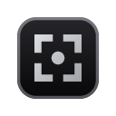
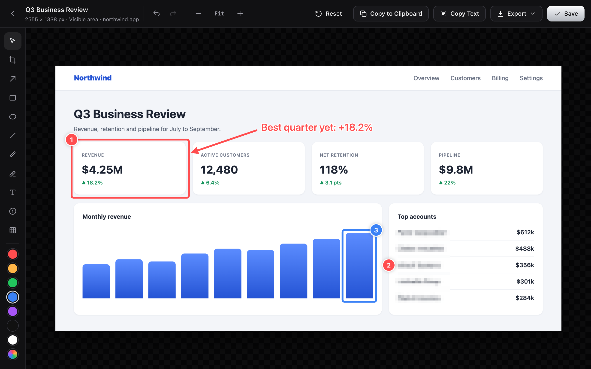
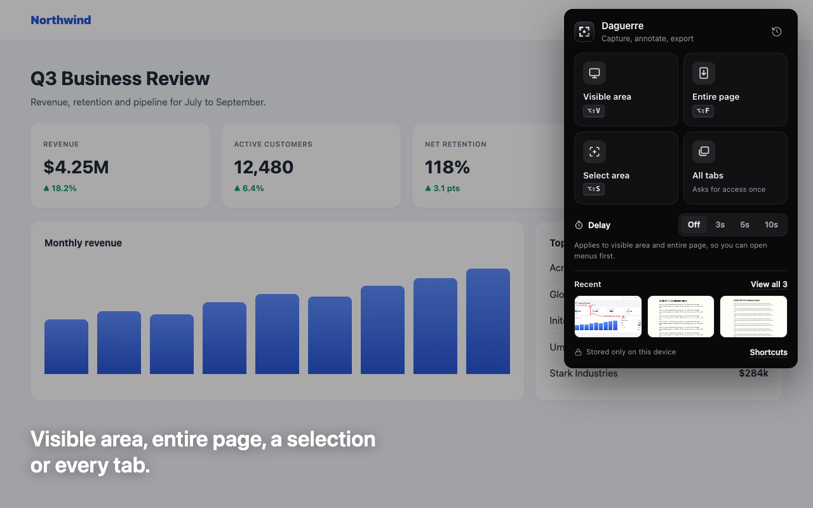
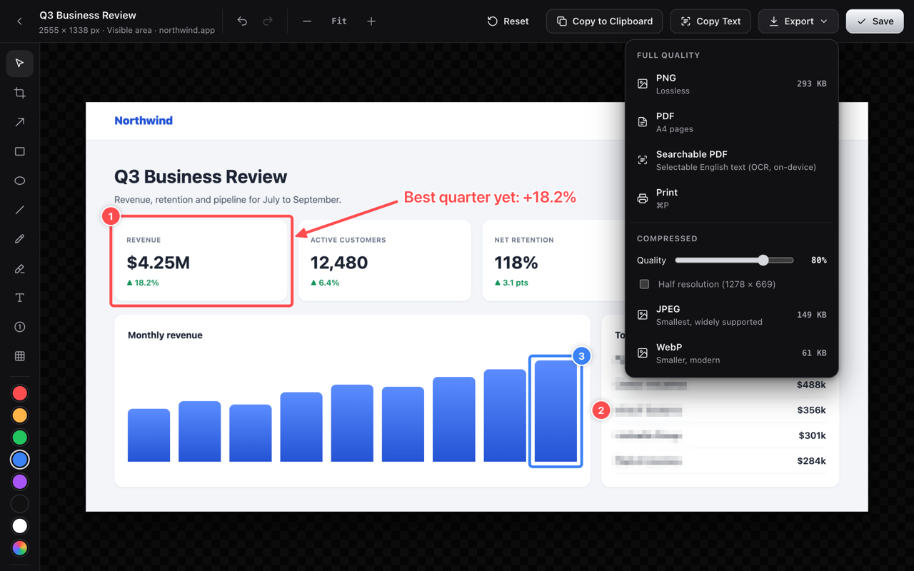
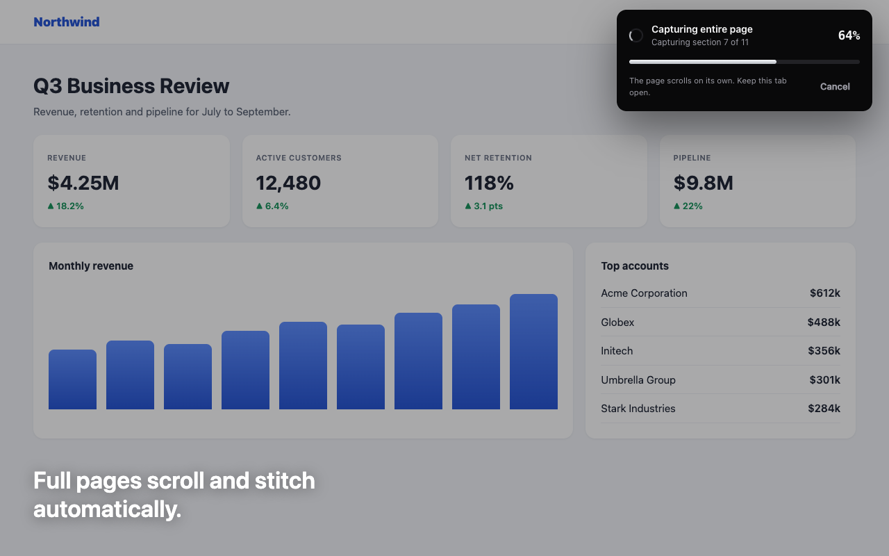
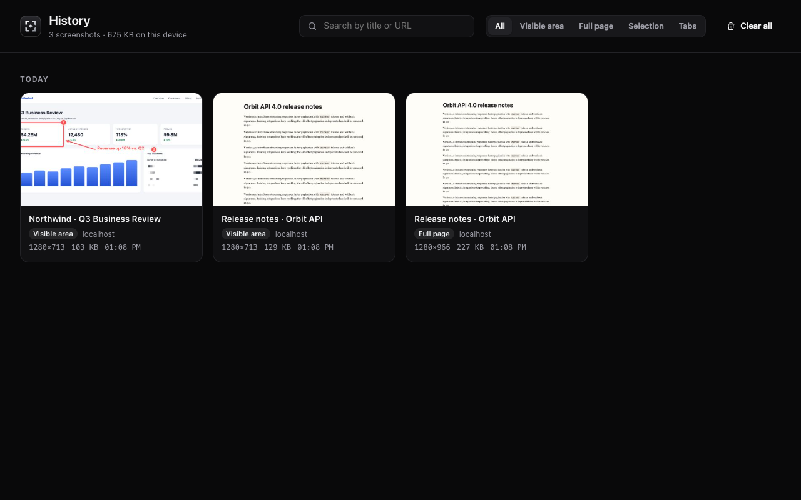

<div align="center">



# Daguerre

**Screenshots, plated in silver.** Capture, annotate and export screenshots in Chrome without anything leaving your browser.

[](https://github.com/MohammadMahmoud/Daguerre/actions/workflows/ci.yml)
[](https://OWNER.github.io/REPO/coverage/)
[](https://github.com/MohammadMahmoud/Daguerre/releases/latest)




**[See the interactive showcase →](https://OWNER.github.io/REPO/)**

</div>

> Named after Louis Daguerre, whose 1839 daguerreotype fixed the first practical photographs on silver-plated copper.

## ✨ Features

|                            |                                                                                                                                                                              |
| -------------------------- | ---------------------------------------------------------------------------------------------------------------------------------------------------------------------------- |
| 📸 **Four capture modes**  | Visible area, entire page (scrolls and stitches, hiding repeated sticky headers), a selected area, or every tab in the window.                                               |
| ↕️ **Scrolling selection** | Drag to the top or bottom edge, or scroll, while selecting. Areas taller than the screen are stitched automatically.                                                         |
| ✏️ **Editor**              | Crop with drag handles, arrows, shapes, pen, highlighter, text, numbered steps, and pixelate for hiding sensitive details. Drag past the edge of the view to keep scrolling. |
| 🔁 **Re-editable**         | The original capture and your edits are stored separately. Undo, redo or reset at any time.                                                                                  |
| 📤 **Export**              | Lossless PNG; compressed JPEG or WebP with a quality slider and live size estimates; multi-page PDF; clipboard; print.                                                       |
| 🔤 **Text recognition**    | **Copy Text** from any screenshot and export **Searchable PDFs**, all offline (English).                                                                                     |
| 🗂️ **History**             | Grouped by day, with search, filters, bulk delete with undo, and a storage meter.                                                                                            |
| ⏱️ **Delay timer**         | 3, 5 or 10 seconds, to open menus or hover states before the capture.                                                                                                        |
| 🔒 **Private by design**   | No servers, analytics or tracking. Everything lives in your browser's IndexedDB.                                                                                             |

<table>
  <tr>
    <td></td>
    <td></td>
  </tr>
  <tr>
    <td></td>
    <td></td>
  </tr>
</table>

Choose **Copy selected area** in the popup, or press **Alt+Shift+C**, to select and copy an area without opening the editor. The capture stays in local History for editing later. Other capture actions open the editor as usual.

## ⌨️ Shortcuts

| Action                          | Shortcut                                                                                                                                                                                                                                       |
| ------------------------------- | ---------------------------------------------------------------------------------------------------------------------------------------------------------------------------------------------------------------------------------------------- |
| Copy selected area to clipboard | <kbd>Alt</kbd> + <kbd>Shift</kbd> + <kbd>C</kbd>                                                                                                                                                                                               |
| Capture visible area            | <kbd>Alt</kbd> + <kbd>Shift</kbd> + <kbd>V</kbd>                                                                                                                                                                                               |
| Capture entire page             | <kbd>Alt</kbd> + <kbd>Shift</kbd> + <kbd>F</kbd>                                                                                                                                                                                               |
| Capture selected area           | <kbd>Alt</kbd> + <kbd>Shift</kbd> + <kbd>S</kbd>                                                                                                                                                                                               |
| Editor tools                    | <kbd>V</kbd> select · <kbd>C</kbd> crop · <kbd>A</kbd> arrow · <kbd>R</kbd> rectangle · <kbd>O</kbd> ellipse · <kbd>L</kbd> line · <kbd>P</kbd> pen · <kbd>H</kbd> highlighter · <kbd>T</kbd> text · <kbd>N</kbd> step · <kbd>B</kbd> pixelate |
| Undo / redo                     | <kbd>⌘</kbd> <kbd>Z</kbd> / <kbd>⇧</kbd> <kbd>⌘</kbd> <kbd>Z</kbd>                                                                                                                                                                             |
| Copy image / copy text          | <kbd>⌘</kbd> <kbd>C</kbd> / <kbd>⇧</kbd> <kbd>⌘</kbd> <kbd>C</kbd>                                                                                                                                                                             |
| Save / print                    | <kbd>⌘</kbd> <kbd>S</kbd> / <kbd>⌘</kbd> <kbd>P</kbd>                                                                                                                                                                                          |
| Apply crop                      | <kbd>Enter</kbd>                                                                                                                                                                                                                               |

Capture shortcuts default to **Alt+Shift** on Windows and Linux, and **Option+Shift** on macOS, with the letters shown above. Existing custom assignments are preserved; browser, OS, or other extension shortcuts may prevent a default from registering.

Change the capture shortcuts at `chrome://extensions/shortcuts`.

## 🚀 Getting started

```sh
pnpm install
pnpm build        # typecheck + build into dist/
```

Open `chrome://extensions`, turn on **Developer mode**, click **Load unpacked** and pick `dist/`. After each rebuild, click the reload button on the extension card.

| Script               | What it does                                                                          |
| -------------------- | ------------------------------------------------------------------------------------- |
| `pnpm dev`           | Rebuild on change                                                                     |
| `pnpm test`          | Unit and component tests (Vitest + jsdom)                                             |
| `pnpm coverage`      | Tests with a coverage report; fails below 80% (report in `coverage/`)                 |
| `pnpm icons`         | Regenerate `public/icons`                                                             |
| `pnpm package`       | Build, run tests with coverage, and zip `dist/` into `daguerre.zip` for the Web Store |
| `pnpm release-notes` | Write `release-notes.md` from `CHANGELOG.md`; fails if versions don't match           |

## 🧪 Tests

Unit and component tests live in `test/unit/`, mirroring `src/`. Shared setup is in `test/setup.ts`, and `test/chrome.ts` is an in-memory stand-in for the extension APIs. They run in Vitest with jsdom, fake IndexedDB and a canvas mock, and coverage must stay at or above 80% for statements, branches, functions and lines.

```
test/
├── chrome.ts        # chrome.* API mock
├── setup.ts         # jsdom polyfills (canvas, ImageBitmap, clipboard, layout)
└── unit/
    ├── background.test.ts
    ├── editor.test.tsx
    ├── history.test.tsx
    ├── popup.test.tsx
    ├── editor/draw.test.ts
    └── lib/{db,export,ocr}.test.ts
```

## ⚙️ CI and releases

[`.github/workflows/ci.yml`](.github/workflows/ci.yml) runs on every push and pull request:

1. **Test:** typecheck, then the unit tests with coverage. The job fails below 80% and posts a coverage summary on the run.
2. **Package:** once tests pass, it checks that `package.json`, the manifest and `CHANGELOG.md` agree on the version, runs `pnpm package`, and uploads `daguerre-<version>.zip` plus `release-notes.md` as the run's artifact.
3. **Release:** for a `v*` tag, it creates a GitHub release with the zip attached and that version's changelog as the notes.
4. **Pages:** on `main`, it publishes the [showcase](store/index.html), the [privacy policy](store/privacy.html), the coverage report and the coverage badge.

To ship a version, bump `version` in `package.json` and `public/manifest.json`, add a `## [x.y.z]` section to [CHANGELOG.md](CHANGELOG.md), then tag and push it:

```sh
git tag v1.0.0 && git push origin v1.0.0
```

One-time setup: in **Settings → Pages**, set **Source** to **GitHub Actions**. Then replace `MohammadMahmoud/Daguerre` in this README with your repository.

## 🛡️ Permissions

| Permission                    | Why                                                                           |
| ----------------------------- | ----------------------------------------------------------------------------- |
| `activeTab`                   | Capture the tab you chose from the toolbar, shortcut or right-click menu      |
| `scripting`                   | Scroll the page for full-page and tall selections; show the selection overlay |
| `storage`, `unlimitedStorage` | Settings and the local screenshot history                                     |
| `contextMenus`                | Right-click capture commands                                                  |
| `clipboardWrite`              | Copy images and recognized text                                               |
| `<all_urls>` _(optional)_     | Requested only the first time you choose **All tabs**                         |

There's no `tabs` permission and no remote code; the OCR engine ships inside the extension under `ocr/`.

## 📦 Publishing

- [store/listing.md](store/listing.md): listing copy, permission justifications and a submission checklist.
- [store/index.html](store/index.html): the interactive showcase site (served by GitHub Pages).
- [store/privacy.html](store/privacy.html): the privacy policy to link from the store.
- `store/`: 1280×800 screenshots and the 440×280 promo tile.

## ⚠️ Known limits

- Chrome blocks capturing `chrome://` pages and the Chrome Web Store.
- Full-page capture scrolls the main document. Pages that scroll an inner container (for example, some web apps) are captured as the visible area only.
- Very long pages are cut at Chrome's canvas limit (about 32,000 px tall).
- OCR reads English only, and the searchable PDF's text layer covers Latin characters only. Words that cross a 4,000 px band boundary may be split.

## 🙏 Credits

Text recognition by [Tesseract.js](https://github.com/naptha/tesseract.js) (Apache-2.0).

Daguerre is licensed under the [MIT License](LICENSE).
