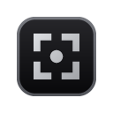
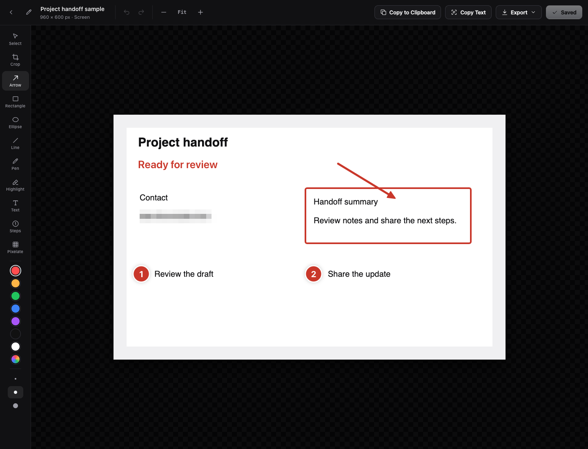
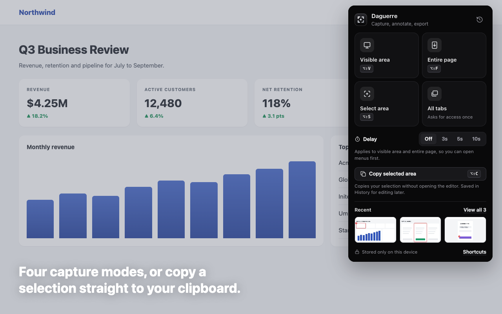
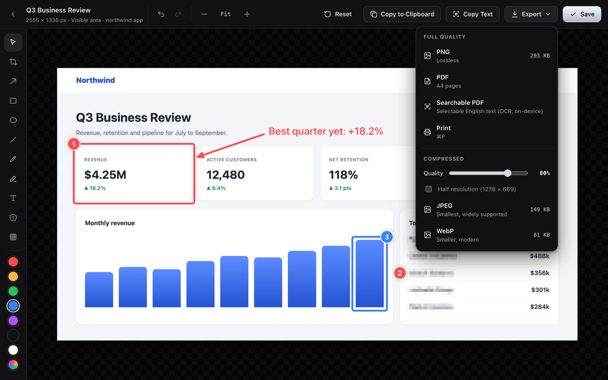
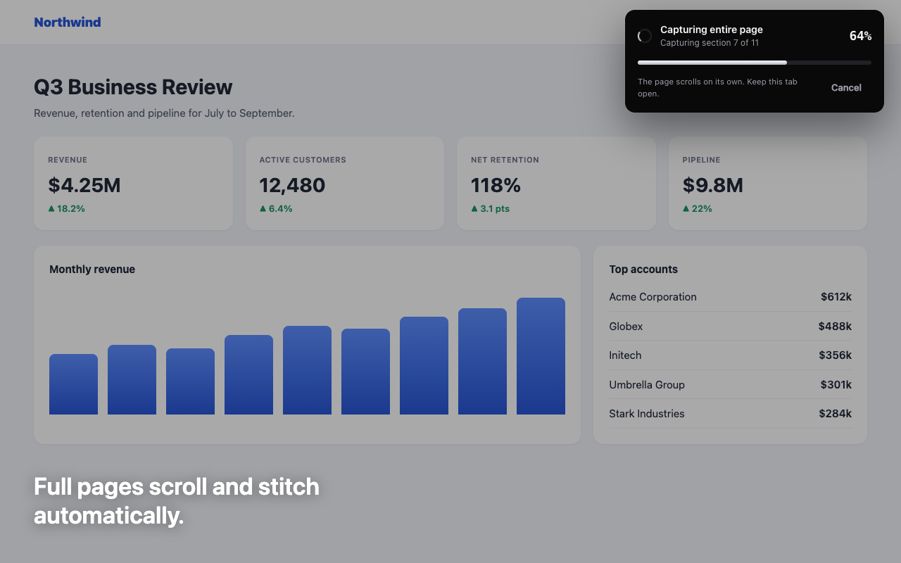
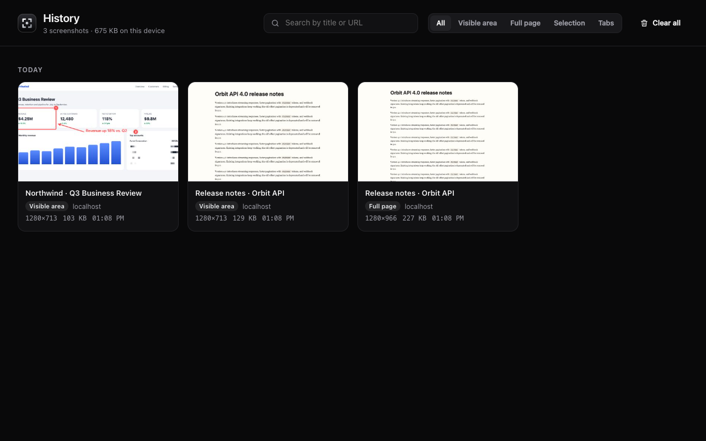
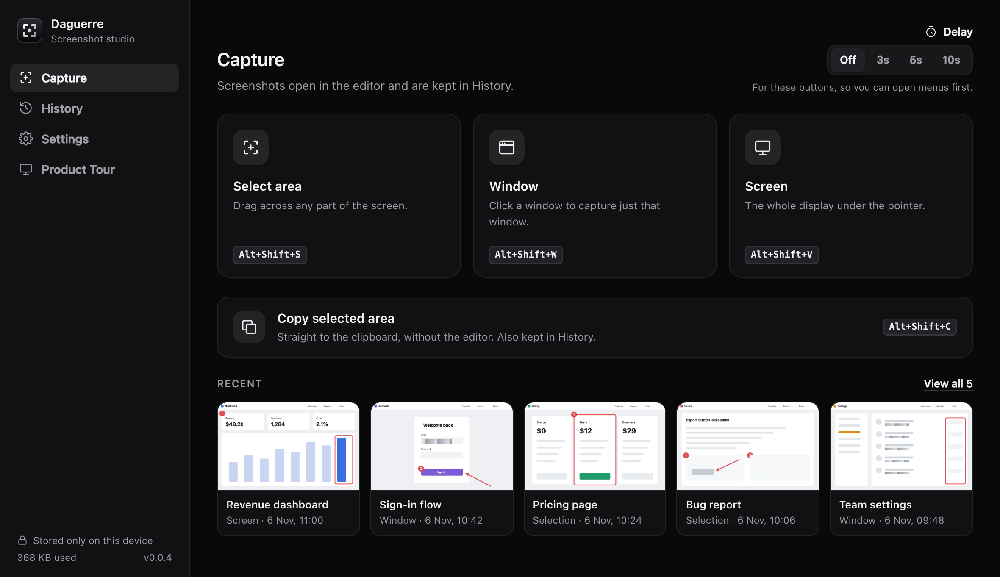
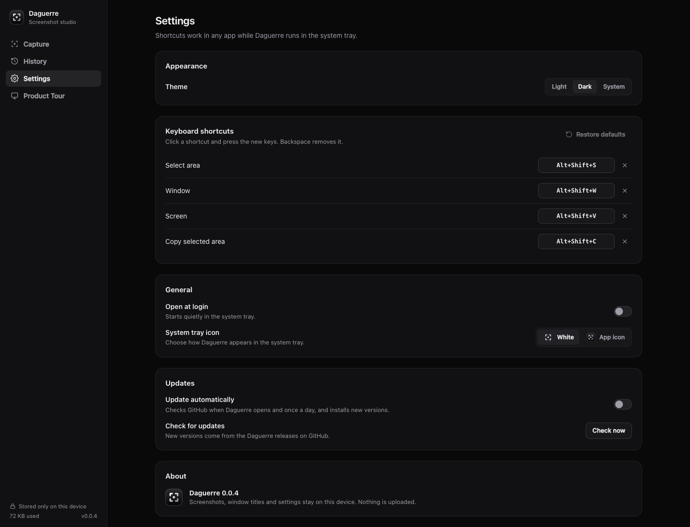
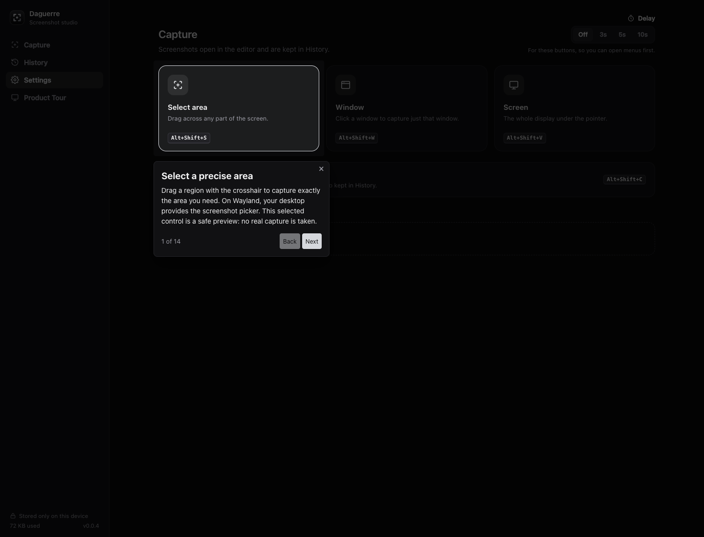

<div align="center">



# Daguerre

**Capture, annotate and export screenshots on your device.** Daguerre is a desktop app for macOS, Windows and Linux and a Chrome browser extension. Use either independently: they share an editor, offline OCR and export tools, but keep separate local screenshot histories. No account or synchronization service is required.

[](https://github.com/MohammadMahmoud/Daguerre/actions/workflows/ci.yml)
[](https://mohammadmahmoud.github.io/Daguerre/coverage/)
[](https://github.com/MohammadMahmoud/Daguerre/releases/latest)




**[See the interactive showcase →](https://mohammadmahmoud.github.io/Daguerre/)**

</div>

> Named after Louis Daguerre, whose 1839 daguerreotype fixed the first practical photographs on silver-plated copper.

## ✨ Browser Extension & Shared Features

The extension captures web pages; the desktop app captures other applications and displays. Both provide the annotation, OCR, export and History features below. Scrolling and all-tab capture are extension-only.

|                            |                                                                                                                                                                              |
| -------------------------- | ---------------------------------------------------------------------------------------------------------------------------------------------------------------------------- |
| 📸 **Four capture modes**  | Visible area, entire page (scrolls and stitches, hiding repeated sticky headers), a selected area, or every tab in the window.                                               |
| ↕️ **Scrolling selection** | Drag to the top or bottom edge, or scroll, while selecting. Areas taller than the screen are stitched automatically.                                                         |
| ✏️ **Editor**              | Crop with drag handles, arrows, shapes, pen, highlighter, text, numbered steps, and pixelate for hiding sensitive details. Drag past the edge of the view to keep scrolling. |
| 🔁 **Re-editable**         | The original capture and your edits are stored separately. Undo, redo or reset at any time.                                                                                  |
| 📤 **Export**              | Lossless PNG; compressed JPEG or WebP with a quality slider and live size estimates; multi-page PDF; clipboard; print.                                                       |
| 🔤 **Text recognition**    | **Copy Text** from any screenshot and export **Searchable PDFs**, all offline (English).                                                                                     |
| 🗂️ **History**             | Grouped by day, with search, filters, bulk delete with undo, and a storage meter.                                                                                            |
| ⏱️ **Delay timer**         | 3, 5 or 10 seconds, to open menus or hover states before the capture.                                                                                                        |
| 🔒 **Private by design**   | No servers, analytics or tracking. Everything lives in your browser's IndexedDB.                                                                                             |

<table>
  <tr>
    <td></td>
    <td></td>
  </tr>
  <tr>
    <td></td>
    <td></td>
  </tr>
</table>

Choose **Copy selected area** in the popup, or press **Alt+Shift+C**, to select and copy an area without opening the editor. The capture stays in local History for editing later. Other capture actions open the editor as usual.

Start a browser capture from the toolbar popup, a capture shortcut or the page's right-click menu. The popup provides capture modes, the delay timer, progress/cancel controls and access to History. The Manifest V3 background service worker injects selection and scrolling functions into the active page on demand; no persistent content script is installed. It stitches full-page or tall-selection captures and opens the shared editor. The direct-copy workflow briefly focuses an extension clipboard frame instead. **All tabs** requests optional site access on first use. Production files, including the manifest, service worker, popup, editor, History and bundled OCR assets, are written to `dist/`.

Every GitHub Release includes `daguerre-extension-dist-vX.Y.Z.zip` alongside desktop installers. Extract it and choose the enclosed `dist/` folder in **Load unpacked**. Desktop and extension work independently; neither needs the other installed.

## ⌨️ Shortcuts

| Action                          | Shortcut                                                                                                                                                                                                                                       |
| ------------------------------- | ---------------------------------------------------------------------------------------------------------------------------------------------------------------------------------------------------------------------------------------------- |
| Copy selected area to clipboard | <kbd>Alt</kbd> + <kbd>Shift</kbd> + <kbd>C</kbd>                                                                                                                                                                                               |
| Capture visible area            | <kbd>Alt</kbd> + <kbd>Shift</kbd> + <kbd>V</kbd>                                                                                                                                                                                               |
| Capture entire page             | <kbd>Alt</kbd> + <kbd>Shift</kbd> + <kbd>F</kbd>                                                                                                                                                                                               |
| Capture selected area           | <kbd>Alt</kbd> + <kbd>Shift</kbd> + <kbd>S</kbd>                                                                                                                                                                                               |
| Editor tools                    | <kbd>V</kbd> select · <kbd>C</kbd> crop · <kbd>A</kbd> arrow · <kbd>R</kbd> rectangle · <kbd>O</kbd> ellipse · <kbd>L</kbd> line · <kbd>P</kbd> pen · <kbd>H</kbd> highlighter · <kbd>T</kbd> text · <kbd>N</kbd> step · <kbd>B</kbd> pixelate |
| Undo / redo                     | <kbd>⌘</kbd> <kbd>Z</kbd> / <kbd>⇧</kbd> <kbd>⌘</kbd> <kbd>Z</kbd>                                                                                                                                                                             |
| Copy image / copy text          | <kbd>⌘</kbd> <kbd>C</kbd> / <kbd>⇧</kbd> <kbd>⌘</kbd> <kbd>C</kbd>                                                                                                                                                                             |
| Save / print                    | <kbd>⌘</kbd> <kbd>S</kbd> / <kbd>⌘</kbd> <kbd>P</kbd>                                                                                                                                                                                          |
| Apply crop                      | <kbd>Enter</kbd>                                                                                                                                                                                                                               |

Capture shortcuts default to **Alt+Shift** on Windows and Linux, and **Option+Shift** on macOS, with the letters shown above. Existing custom assignments are preserved; browser, OS, or other extension shortcuts may prevent a default from registering.

Change the capture shortcuts at `chrome://extensions/shortcuts`.

## 🚀 Getting started

```sh
pnpm install
pnpm build        # typecheck + build into dist/
```

Open `chrome://extensions`, turn on **Developer mode**, click **Load unpacked** and pick `dist/`. After each rebuild, click the reload button on the extension card.

| Script                   | What it does                                                                          |
| ------------------------ | ------------------------------------------------------------------------------------- |
| `pnpm dev`               | Rebuild on change                                                                     |
| `pnpm test`              | Unit and component tests (Vitest + jsdom)                                             |
| `pnpm coverage`          | Tests with a coverage report; fails below 80% (report in `coverage/`)                 |
| `pnpm icons`             | Regenerate `public/icons`                                                             |
| `pnpm package`           | Build, run tests with coverage, and zip `dist/` into `daguerre.zip` for the Web Store |
| `pnpm changelog:update`  | CI release preparation: prepend generated notes to CHANGELOG.md                       |
| `pnpm release-notes all` | Extract a committed release section to ignored `.release-notes.md`                    |
| `pnpm extension:verify`  | Verify `dist/manifest.json`, entry points, assets and OCR output                      |
| `pnpm publish:release`   | Dispatch the main-branch release workflow without changing local files                |

## 🖥️ Desktop app

The same editor, History, OCR and export, as a desktop app for macOS, Windows and Linux. It is built with [Tauri 2](https://v2.tauri.app/): Rust captures screens and windows ([xcap](https://github.com/nashaofu/xcap)), shows the selection overlay, registers global shortcuts and writes the clipboard, while the web UI from `src/` is reused. Screenshots stay in the app's local storage.

The four desktop capture workflows are **Select area**, **Window**, **Screen**, and **Copy selected area**. The first three open the editor; Copy selected area immediately copies the image to the system clipboard and keeps it in History. Capture controls, global shortcuts, tray actions and `daguerre --capture <selection|window|screen|copy-selection>` provide access to these workflows. The Capture page also has a 3, 5 or 10 second delay and recent captures.



| Workflow           | What happens                                                                                            |
| ------------------ | ------------------------------------------------------------------------------------------------------- |
| Select area        | Freeze the display, drag a region, then annotate it in an editor window.                                |
| Window             | Pick a window and open its capture in the editor; unavailable on Wayland.                               |
| Screen             | Capture the display under the pointer; Wayland captures the whole desktop through its portal.           |
| Copy selected area | Drag a region and immediately copy the image, without opening the editor; keep it in History for later. |

The shared editing suite includes **Pixelate**, **Numbered Steps**, **Text**, **Arrows**, rectangles, ellipses, lines, pen, highlighter, crop, undo and redo. **Copy Text** extracts English text locally. Copy the edited image instantly or export PNG, JPEG, WebP, multi-page PDF and **Searchable PDF**, with compression controls, size estimates and printing.

Each annotation tool has a persistent sub-label beneath its icon: you can identify tools immediately without hovering. The tour simulates toggling those tools, previews the export menu and changes themes live, without committing edits or exports.

The main window has **Capture**, **History** (search, filters, bulk delete) and **Settings** (shortcuts, open at login, permissions, appearance and updates). Each screenshot opens in its own editor window, which asks before closing with unsaved changes. Closing the main window keeps Daguerre running in the menu bar or system tray, where it still answers shortcuts; the tray menu has every capture plus History and Settings. Window sizes and positions are remembered. Onboarding uses **driver.js**.

A 14-step interactive product tour opens on first launch. It previews all four desktop capture workflows, opens the real editor with an in-memory sample, demonstrates annotation tools and export options, and previews the available themes. Back works across screens; completing or dismissing the tour removes the sample and restores your original view and appearance without changing History, the clipboard, or saved preferences. **Product Tour**, directly below **Settings**, replays it anytime. Annotation tools show their names below their icons. In **Settings → Appearance**, macOS retains the Liquid Glass slider; Windows and Linux offer **Light**, **Dark**, and **System**. Existing glass preferences on Windows/Linux migrate to Dark, and solid theme choices also apply to editor windows.

<table>
  <tr>
    <td></td>
    <td></td>
  </tr>
</table>

Current UI previews use a disposable sample and mocked native APIs. macOS-only Liquid Glass is a native effect; these screenshots show Windows-style solid themes.

| Download from a release         | File                                                              |
| ------------------------------- | ----------------------------------------------------------------- |
| macOS (Apple silicon and Intel) | `Daguerre_<version>_universal.dmg`                                |
| Windows                         | `Daguerre_<version>_x64-setup.exe` or `.msi`                      |
| Linux                           | `.AppImage`, `.deb` (Debian, Ubuntu) or `.rpm` (Fedora, openSUSE) |

Each release also lists `SHA256SUMS.txt` to check your download (`shasum -a 256 -c SHA256SUMS.txt --ignore-missing`).

| Action             | Default shortcut                                                |
| ------------------ | --------------------------------------------------------------- |
| Select area        | <kbd>Alt</kbd> + <kbd>Shift</kbd> + <kbd>S</kbd> (⌥⇧S on macOS) |
| Window             | <kbd>Alt</kbd> + <kbd>Shift</kbd> + <kbd>W</kbd> (⌥⇧W)          |
| Screen             | <kbd>Alt</kbd> + <kbd>Shift</kbd> + <kbd>V</kbd> (⌥⇧V)          |
| Copy selected area | <kbd>Alt</kbd> + <kbd>Shift</kbd> + <kbd>C</kbd> (⌥⇧C)          |

Change them in **Settings** (shortcuts pause while you record a new one). Selections freeze the screen first, so menus and hover states stay in the shot; press <kbd>Esc</kbd> to cancel.

- **macOS:** allow **Screen Recording** for Daguerre (the app shows an **Allow** button), then quit and reopen it. Unless the release was signed (see below), builds are ad-hoc signed and not notarized: if macOS blocks the first launch, click **Open Anyway** in System Settings → Privacy & Security, or run `xattr -dr com.apple.quarantine /Applications/Daguerre.app`. The Dock icon shows only while a Daguerre window is open.
- **Windows:** unsigned installers show a SmartScreen warning; choose **More info → Run anyway**.
- **Linux (Wayland):** apps can't register global shortcuts. Bind `daguerre --capture selection` (or `window`, `screen`, `copy-selection`) in your desktop's keyboard settings. Window picking needs X11.

Build from source with Rust 1.90 or newer ([rustup](https://rustup.rs); make sure `cargo` is on your `PATH`). On Linux, use Ubuntu 24.04 or equivalent and install the [Tauri prerequisites](https://v2.tauri.app/start/prerequisites/#linux) plus `libxcb1-dev libxrandr-dev libdbus-1-dev libpipewire-0.3-dev libwayland-dev libegl-dev libgbm-dev libclang-dev`.

| Script               | What it does                                                          |
| -------------------- | --------------------------------------------------------------------- |
| `pnpm desktop:dev`   | Build the UI and run the app, rebuilding the UI on change             |
| `pnpm desktop:build` | Typecheck and build installers into `src-tauri/target/release/bundle` |

The Rust side lives in `src-tauri/` (`capture.rs`, `selection.rs`, `lib.rs`); each window only gets the commands listed in `src-tauri/capabilities/`. Run its checks with `cargo fmt --check`, `cargo clippy --all-targets -- -D warnings` and `cargo test` inside `src-tauri/`.

## 🧪 Tests

Unit and component tests live in `test/unit/`, mirroring `src/`. Shared setup is in `test/setup.ts`, and `test/chrome.ts` is an in-memory stand-in for the extension APIs. They run in Vitest with jsdom, fake IndexedDB and a canvas mock, and coverage must stay at or above 80% for statements, branches, functions and lines.

```
test/
├── chrome.ts        # chrome.* API mock
├── setup.ts         # jsdom polyfills (canvas, ImageBitmap, clipboard, layout)
└── unit/
    ├── background.test.ts
    ├── editor.test.tsx
    ├── history.test.tsx
    ├── popup.test.tsx
    ├── desktop/{Capture,Desktop,Shortcuts}.test.ts, {Editor,Home,Overlay}.test.tsx
    ├── editor/draw.test.ts
    ├── lib/{db,export,ocr}.test.ts
    └── ui.test.tsx
```

The Rust code in `src-tauri/` has its own unit tests (`cargo test`) for coordinate mapping, window picking, command-line arguments, shortcut filtering and editor window labels.

## CI and Releases

[.github/workflows/ci.yml](.github/workflows/ci.yml) runs checks on `main`, pull requests and manual dispatch, and is reused by the release workflow:

1. **Quality:** typecheck, lint, formatting and Vitest coverage, with an 80% floor for statements, branches, functions and lines.
2. **Extension:** affected changes build and test `dist/`; `pnpm extension:verify` rejects a missing manifest, stale version or incomplete output. CI preserves the unpacked `extension-dist` artifact and uploads `extension-dist.zip` with the manifest at the archive root.
3. **Desktop:** affected changes run Rust formatting, Clippy and tests on macOS, Windows and Ubuntu 24.04, plus Linux portal lifecycle tests. Non-PR runs build the platform installers.
4. **Release:** [.github/workflows/release.yml](.github/workflows/release.yml) prepares one synchronized version on remote `main`, calls CI with that immutable release commit, and attaches desktop installers, `daguerre-extension-dist-vX.Y.Z.zip` and checksums to one GitHub Release. The extension archive preserves the `dist/` directory. Legacy product tags remain historical references, not publishing triggers.
5. **Pages:** `main` publishes the showcase, privacy policy and coverage report. Set **Settings → Pages → Source** to **GitHub Actions** once.

## Publishing a Release

### Prerequisites

- Merge the desired features into `main` first. Releases always use remote `main`; a `release/**` branch push requests a release but does not publish unmerged branch code. Keep commit messages clear and user-oriented, preferably `feat:`, `fix:` or `docs:`/`chore:`.
- For the local trigger, install GitHub CLI and authenticate with `gh auth login` using an account allowed to dispatch Actions, or provide an appropriate `GH_TOKEN` outside the repository. No local Rust build is required to request a release. You can also use **Actions → Release → Run workflow** on `main` without the CLI.
- Enable Actions and allow the preparation job's `contents: write` permission. Branch and tag protections must permit `github-actions[bot]` to push the release metadata and tag; otherwise preparation fails without force-pushing. CI uses the supplied `GITHUB_TOKEN`, not a committed personal token. Reusable CI retains its Pages permissions, but Pages is skipped during releases.
- [CHANGELOG.md](CHANGELOG.md) is the only source of release history. Release CI generates its new **Added**, **Fixed**, and **Changed** section from commits since the previous unified tag. [AGENT.md](AGENT.md) is maintained deliberately when architecture changes. Local hooks run quality checks only: no post-commit/post-merge amendment or changelog generation on feature branches.
- Optional macOS signing/notarization secrets: `APPLE_CERTIFICATE` (base64 Developer ID `.p12`), `APPLE_CERTIFICATE_PASSWORD`, `APPLE_SIGNING_IDENTITY`, `APPLE_ID`, `APPLE_PASSWORD` (app-specific), `APPLE_TEAM_ID`. Without them macOS builds remain ad-hoc signed. See [Tauri's signing guide](https://v2.tauri.app/distribute/sign/macos/).
- For signed in-app updates, set repository secrets `TAURI_SIGNING_PRIVATE_KEY` and, when needed, `TAURI_SIGNING_PRIVATE_KEY_PASSWORD`. The private key must match the public key in [src-tauri/tauri.conf.json](src-tauri/tauri.conf.json). CI then publishes signatures and `latest.json`; without the key installers still publish, but the updater manifest is omitted. Never commit signing keys or tokens. Windows installers currently have no signing configuration.

### Publish

```sh
pnpm publish:release --dry-run                # print the dispatch command only
pnpm publish:release                          # automatically calculate the next version in CI
pnpm publish:release --version 0.1.0           # explicit version override
# npm equivalent: npm run publish:release -- --version 0.1.0
```

`pnpm release` is an alias. The script runs `gh workflow run release.yml --ref main`, optionally with `target_version`. It never rewrites local manifests, changelogs, commits or tags, even when called from a feature branch with uncommitted changes. The workflow must already exist on remote `main` before dispatching it. There is no registry-publishing lifecycle alias.

### Automatic Versions and Changelog

[scripts/bump-version.mjs](scripts/bump-version.mjs) fetches tags in CI and uses the nearest reachable unified `vX.Y.Z` tag, falling back to the root package version if none exists. It increments the patch until 9, then increments the minor and resets the patch: `0.0.4 → 0.0.5 → … → 0.0.9 → 0.1.0 → … → 0.1.9 → 0.2.0`. Historical versions with patches above 9 also roll to the next minor. With today's package baseline `1.0.0` and no unified tags, the default first unified version is `1.0.1`.

`--version X.Y.Z` or the workflow's `target_version` input selects that exact numeric version. It must be unused and newer than a previous unified release. Do not choose an override below a previously distributed product version if you expect Chrome Web Store updates or desktop updater upgrades to recognize it.

All manifests are validated first, then updated as a single transaction with rollback on write failure: root and workspace package files, Tauri config, Cargo manifest/lock and extension manifest. No developer needs to bump them on a feature branch.

[scripts/update-changelog.mjs](scripts/update-changelog.mjs) first looks for a curated `## [Unreleased]` section in CHANGELOG.md. If it has entries, CI renames it to `## [vX.Y.Z] - YYYY-MM-DD` and uses it verbatim. Otherwise it groups commit summaries since the previous unified tag (or, before the first one, the newest legacy tag) into **Added**, **Fixed**, and **Changed**, deduplicates identical entries, and prepends the section above existing history. It writes that exact section to ignored `.release-notes.md`; after formatting, CI extracts it again so the GitHub Release body matches the committed changelog verbatim. Existing historical entries are preserved. Fill the Unreleased section just before releasing, or keep commit subjects clear for the generated fallback.

### Pipeline Sequence

1. A manual dispatch, local publish command or `release/**` branch push enters the serialized `release-main` queue. Release runs never cancel one another.
2. CI checks out fresh `main`, calculates the version, synchronizes manifests and generates the changelog. It runs checks and a production extension build, rejecting missing or invalid `dist/manifest.json` and incomplete assets.
3. The bot commits `chore(release): vX.Y.Z [skip ci]`, creates an annotated tag and atomically pushes `main` and the tag. A concurrent ordinary push to `main` makes the push fail safely rather than overwrite work.
4. Reusable CI builds and tests both targets from that exact commit. The publishing job verifies the extension output again, archives the complete `dist/` folder, collects all installers, optional updater signatures and `latest.json`, and writes `SHA256SUMS.txt`.
5. Once every required build succeeds, GitHub publishes the release with the exact changelog section and all assets. This does not submit the extension to the Chrome Web Store; that remains a separate [store submission](store/listing.md).

Follow **Actions → Release** or `gh run list --workflow release.yml`. If preparation fails, fix the reported issue and dispatch again. If a build fails after the tag was pushed, rerun **failed jobs** to reuse the prepared version and commit; rerunning the whole workflow requests another automatic bump. Never silently move a published tag. GitHub concurrency allows one running and one pending run; additional requests may replace the pending run, so check the Actions queue before dispatching repeatedly.

## 🛡️ Permissions

| Permission                    | Why                                                                           |
| ----------------------------- | ----------------------------------------------------------------------------- |
| `activeTab`                   | Capture the tab you chose from the toolbar, shortcut or right-click menu      |
| `scripting`                   | Scroll the page for full-page and tall selections; show the selection overlay |
| `storage`, `unlimitedStorage` | Settings and the local screenshot history                                     |
| `contextMenus`                | Right-click capture commands                                                  |
| `clipboardWrite`              | Copy images and recognized text                                               |
| `<all_urls>` _(optional)_     | Requested only the first time you choose **All tabs**                         |

There's no `tabs` permission and no remote code; the OCR engine ships inside the extension under `ocr/`.

## 📦 Publishing

- [store/listing.md](store/listing.md): listing copy, permission justifications and a submission checklist.
- [store/index.html](store/index.html): the interactive showcase site (served by GitHub Pages).
- [store/privacy.html](store/privacy.html): the privacy policy to link from the store.
- `store/`: 1280×800 screenshots and the 440×280 promo tile.

## ⚠️ Known limits

- Chrome blocks capturing `chrome://` pages and the Chrome Web Store.
- Full-page capture scrolls the main document. Pages that scroll an inner container (for example, some web apps) are captured as the visible area only.
- Very long pages are cut at Chrome's canvas limit (about 32,000 px tall).
- OCR reads English only, and the searchable PDF's text layer covers Latin characters only. Words that cross a 4,000 px band boundary may be split.
- Desktop: a selection stays within one display, and there's no scrolling capture of other apps.

## 🙏 Credits

Text recognition by [Tesseract.js](https://github.com/naptha/tesseract.js) (Apache-2.0).

Daguerre is licensed under the [MIT License](LICENSE).
