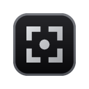
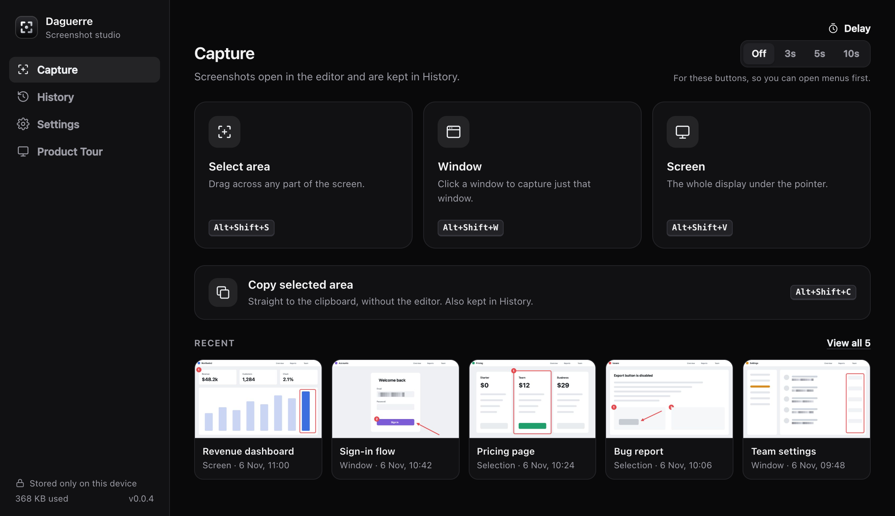
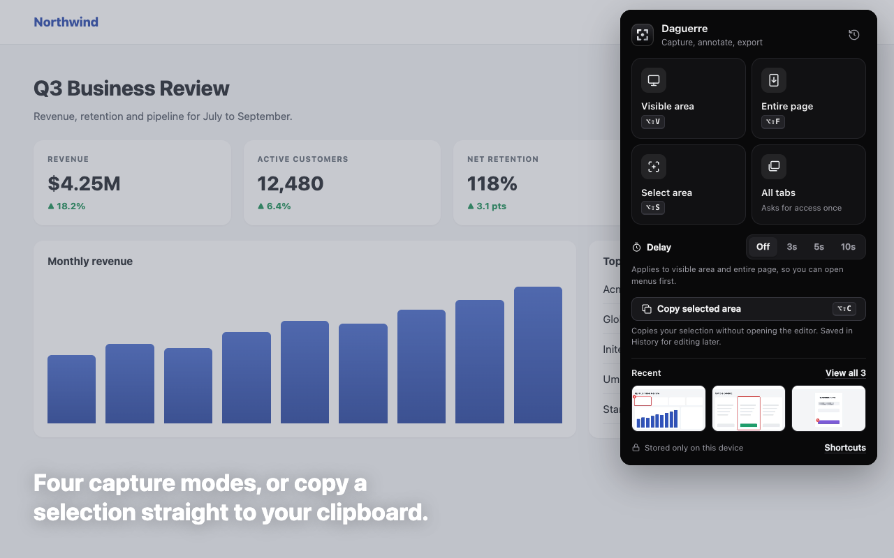
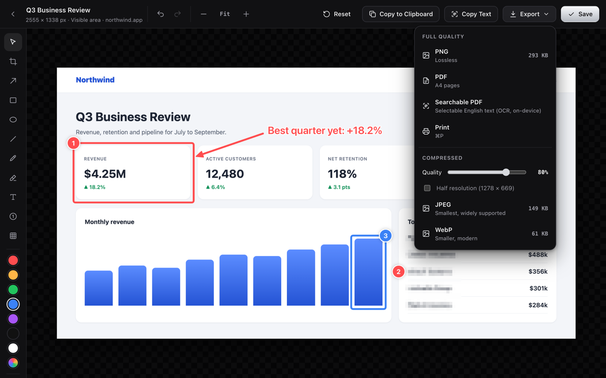
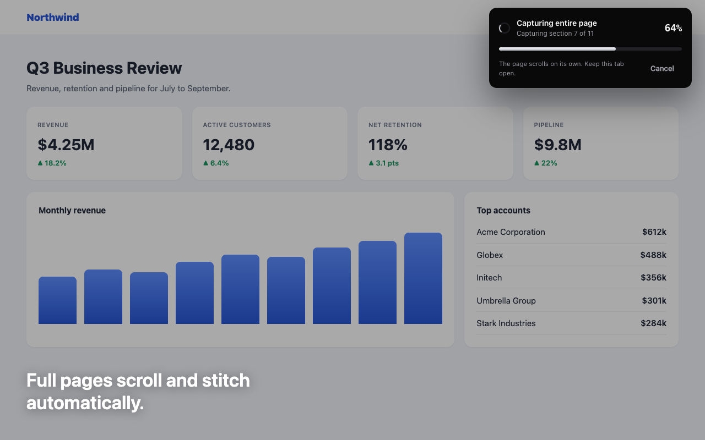
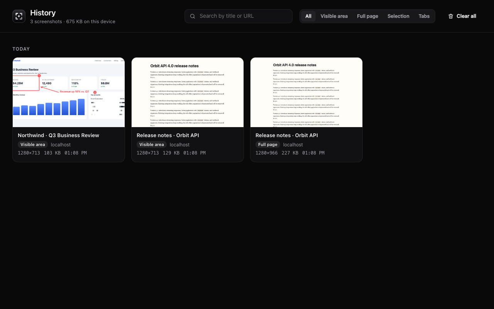
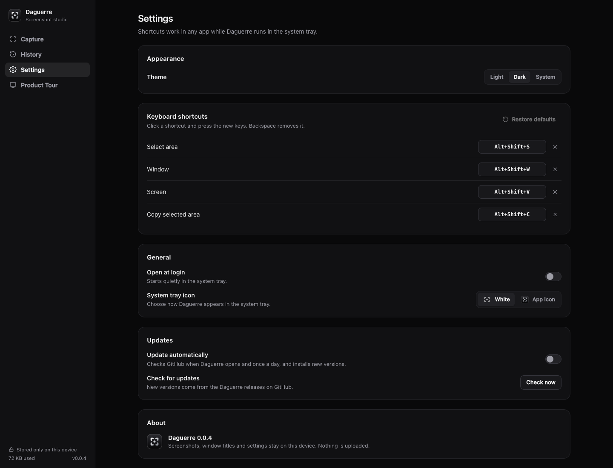
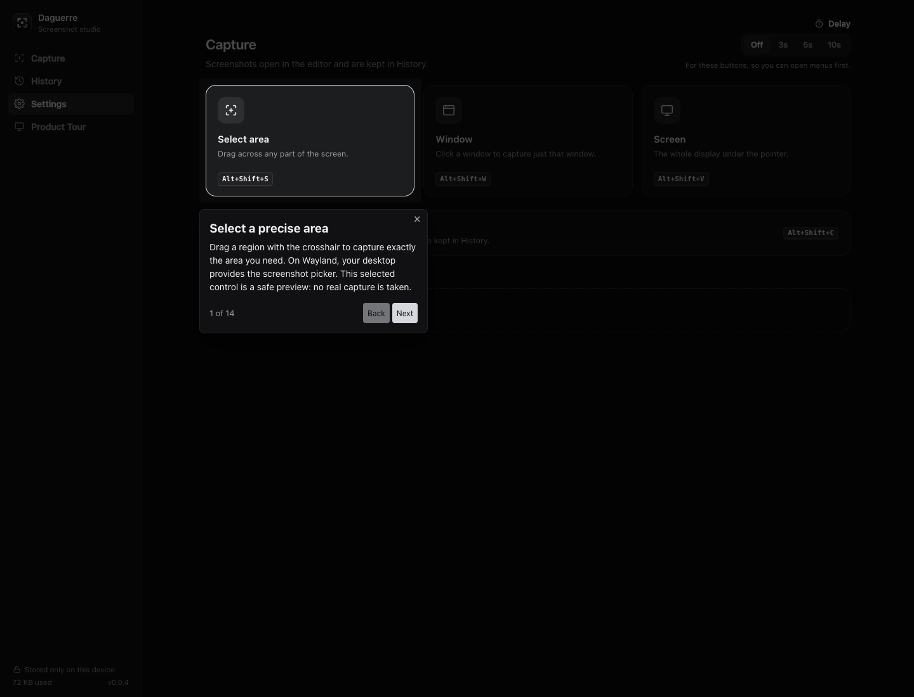

<div align="center">



# Daguerre

**Capture, annotate and export screenshots on your device.** Daguerre is a desktop app for macOS, Windows and Linux and a Chrome browser extension. Use either independently: they share an editor, offline OCR and export tools, but keep separate local screenshot histories. No account or synchronization service is required.

[](https://github.com/MohammadMahmoud/Daguerre/actions/workflows/ci.yml)
[](https://mohammadmahmoud.github.io/Daguerre/coverage/)
[](https://github.com/MohammadMahmoud/Daguerre/releases/latest)
[](https://chromewebstore.google.com/detail/daguerre-%E2%80%94-screenshot-stu/acldkhgnbgbjdcjcjhmgipmimdegmjbc)


[](https://buymeacoffee.com/projectra)



**[Install from the Chrome Web Store →](https://chromewebstore.google.com/detail/daguerre-%E2%80%94-screenshot-stu/acldkhgnbgbjdcjcjhmgipmimdegmjbc)** · **[Download for desktop →](https://github.com/MohammadMahmoud/Daguerre/releases/latest)** · **[See the interactive showcase →](https://mohammadmahmoud.github.io/Daguerre/)**

</div>

> Named after Louis Daguerre, whose 1839 daguerreotype fixed the first practical photographs on silver-plated copper.

## ✨ Browser Extension & Shared Features

The extension captures web pages; the desktop app captures other applications and displays. Both provide the annotation, OCR, export and History features below. Scrolling and all-tab capture are extension-only.

|                            |                                                                                                                                                                                                                                                                                                                                                                                                                                                                       |
| -------------------------- | --------------------------------------------------------------------------------------------------------------------------------------------------------------------------------------------------------------------------------------------------------------------------------------------------------------------------------------------------------------------------------------------------------------------------------------------------------------------- |
| 📸 **Four capture modes**  | Visible area, entire page (scrolls and stitches, hiding repeated sticky headers), a selected area, or every tab in the window.                                                                                                                                                                                                                                                                                                                                        |
| ↕️ **Scrolling selection** | Drag to the top or bottom edge, or scroll, while selecting. Areas taller than the screen are stitched automatically.                                                                                                                                                                                                                                                                                                                                                  |
| ✏️ **Editor**              | Select tool (<kbd>V</kbd>) moves shapes or pans zoomed canvases when dragging empty space; zoom toward the mouse cursor via touchpad pinch, <kbd>Ctrl</kbd> + mouse wheel, or <kbd>+</kbd>/<kbd>-</kbd>, and reset/center via the zoom readout (<kbd>0</kbd>); crop with drag handles, arrows, shapes, pen, highlighter, text, numbered steps, and pixelate for hiding sensitive details. Drag past the edge of the view or scroll freely on long full-page captures. |
| 🔁 **Re-editable**         | The original capture and your edits are stored separately. Undo, redo or reset at any time.                                                                                                                                                                                                                                                                                                                                                                           |
| 📤 **Export**              | Lossless PNG; compressed JPEG or WebP with a quality slider and live size estimates; multi-page PDF; clipboard; print.                                                                                                                                                                                                                                                                                                                                                |
| 🔤 **Text recognition**    | Interactive **Live Text** selection directly on the image, **Copy Text** from any screenshot, and export **Searchable PDFs**, all offline (universal Latin script & diacritics including English and German).                                                                                                                                                                                                                                                         |
| 🗂️ **History**             | Grouped by day, with search, filters, bulk delete with undo, and a storage meter.                                                                                                                                                                                                                                                                                                                                                                                     |
| ⏱️ **Delay timer**         | 3, 5 or 10 seconds, to open menus or hover states before the capture.                                                                                                                                                                                                                                                                                                                                                                                                 |
| 💫 **Apple-grade motion**  | Damped spring curves, hover elevation with dynamic shadow bloom, active tactile compression, micro-interactions, and view transitions across Light, Dark, and Liquid Glass.                                                                                                                                                                                                                                                                                           |     |
| 🔒 **Private by design**   | No servers, analytics or tracking. Everything lives in your browser's IndexedDB.                                                                                                                                                                                                                                                                                                                                                                                      |

<table>
  <tr>
    <td></td>
    <td></td>
  </tr>
  <tr>
    <td></td>
    <td></td>
  </tr>
</table>

Choose **Copy selected area** in the popup, or press **Alt+Shift+C**, to select and copy an area without opening the editor. The capture stays in local History for editing later. Other capture actions open the editor as usual.

Start a browser capture from the toolbar popup, a capture shortcut or the page's right-click menu. The popup provides capture modes, the delay timer, progress/cancel controls and access to History. The Manifest V3 background service worker injects selection and scrolling functions into the active page on demand; no persistent content script is installed. It stitches full-page or tall-selection captures and opens the shared editor. The direct-copy workflow briefly focuses an extension clipboard frame instead. **All tabs** requests optional site access on first use. Production files, including the manifest, service worker, popup, editor, History and bundled OCR assets, are written to `dist/`.

Install the browser extension directly from the [Chrome Web Store](https://chromewebstore.google.com/detail/daguerre-%E2%80%94-screenshot-stu/acldkhgnbgbjdcjcjhmgipmimdegmjbc), or from a GitHub Release: every release includes `daguerre-extension-dist-vX.Y.Z.zip` alongside desktop installers. Extract it and choose the enclosed `dist/` folder in **Load unpacked**. Desktop and extension work independently; neither needs the other installed.

## ⌨️ Shortcuts

| Action                          | Shortcut                                                                                                                                                                                                                                             |
| ------------------------------- | ---------------------------------------------------------------------------------------------------------------------------------------------------------------------------------------------------------------------------------------------------- |
| Copy selected area to clipboard | <kbd>Alt</kbd> + <kbd>Shift</kbd> + <kbd>C</kbd>                                                                                                                                                                                                     |
| Capture visible area            | <kbd>Alt</kbd> + <kbd>Shift</kbd> + <kbd>V</kbd>                                                                                                                                                                                                     |
| Capture entire page             | <kbd>Alt</kbd> + <kbd>Shift</kbd> + <kbd>F</kbd>                                                                                                                                                                                                     |
| Capture selected area           | <kbd>Alt</kbd> + <kbd>Shift</kbd> + <kbd>S</kbd>                                                                                                                                                                                                     |
| Editor tools                    | <kbd>V</kbd> select / pan · <kbd>C</kbd> crop · <kbd>A</kbd> arrow · <kbd>R</kbd> rectangle · <kbd>O</kbd> ellipse · <kbd>L</kbd> line · <kbd>P</kbd> pen · <kbd>H</kbd> highlighter · <kbd>T</kbd> text · <kbd>N</kbd> step · <kbd>B</kbd> pixelate |
| Editor zoom & pan               | <kbd>+</kbd> / <kbd>-</kbd> / <kbd>0</kbd> (or click zoom percentage), <kbd>Ctrl</kbd> + mouse wheel, or touchpad pinch to zoom toward the cursor · drag empty canvas in Select (<kbd>V</kbd>) to pan                                                |
| Undo / redo                     | <kbd>⌘</kbd> <kbd>Z</kbd> / <kbd>⇧</kbd> <kbd>⌘</kbd> <kbd>Z</kbd>                                                                                                                                                                                   |
| Copy image / copy text          | <kbd>⌘</kbd> <kbd>C</kbd> / <kbd>⇧</kbd> <kbd>⌘</kbd> <kbd>C</kbd>                                                                                                                                                                                   |
| Save / print                    | <kbd>⌘</kbd> <kbd>S</kbd> / <kbd>⌘</kbd> <kbd>P</kbd>                                                                                                                                                                                                |
| Apply crop                      | <kbd>Enter</kbd>                                                                                                                                                                                                                                     |

Capture shortcuts default to **Alt+Shift** on Windows and Linux, and **Option+Shift** on macOS, with the letters shown above. Existing custom assignments are preserved; browser, OS, or other extension shortcuts may prevent a default from registering.

Change the capture shortcuts at `chrome://extensions/shortcuts`.

## 🚀 Getting started

```sh
pnpm install
pnpm build        # typecheck + build into dist/
```

Open `chrome://extensions`, turn on **Developer mode**, click **Load unpacked** and pick `dist/`. After each rebuild, click the reload button on the extension card.

| Script                   | What it does                                                                          |
| ------------------------ | ------------------------------------------------------------------------------------- |
| `pnpm dev`               | Rebuild on change                                                                     |
| `pnpm test`              | Unit and component tests (Vitest + jsdom)                                             |
| `pnpm coverage`          | Tests with a coverage report; fails below 80% (report in `coverage/`)                 |
| `pnpm icons`             | Regenerate `public/icons`                                                             |
| `pnpm package`           | Build, run tests with coverage, and zip `dist/` into `daguerre.zip` for the Web Store |
| `pnpm changelog:update`  | Prepend generated release notes to CHANGELOG.md                                       |
| `pnpm release-notes all` | Extract a committed release section to ignored `.release-notes.md`                    |
| `pnpm extension:verify`  | Verify `dist/manifest.json`, entry points, assets and OCR output                      |
| `pnpm publish:release`   | Bump version & changelog, commit/tag locally as you, and push to trigger Release CI   |

## 🖥️ Desktop app

The same editor, History, OCR and export, as a desktop app for macOS, Windows and Linux. It is built with [Tauri 2](https://v2.tauri.app/): Rust captures screens and windows ([xcap](https://github.com/nashaofu/xcap)), shows the selection overlay, registers global shortcuts and writes the clipboard, while the web UI from `src/` is reused. Screenshots stay in the app's local storage.

The four desktop capture workflows are **Select area**, **Window**, **Screen**, and **Copy selected area**. The first three open the editor; Copy selected area immediately copies the image to the system clipboard and keeps it in History. Capture controls, global shortcuts, tray actions and `daguerre --capture <selection|window|screen|copy-selection>` provide access to these workflows. The Capture page also has a 3, 5 or 10 second delay and recent captures.


| Workflow           | What happens                                                                                            |
| ------------------ | ------------------------------------------------------------------------------------------------------- |
| Select area        | Freeze the display, drag a region, then annotate it in an editor window.                                |
| Window             | Pick a window and open its capture in the editor; unavailable on Wayland.                               |
| Screen             | Capture the display under the pointer; Wayland captures the whole desktop through its portal.           |
| Copy selected area | Drag a region and immediately copy the image, without opening the editor; keep it in History for later. |

The shared editing suite includes canvas panning from the **Select** tool when dragging empty space, cursor-anchored zoom via touchpad pinch, `Ctrl` + mouse wheel or `+`/`-` keys (with click-to-fit on the zoom readout), **Pixelate**, **Numbered Steps**, **Text**, **Arrows**, rectangles, ellipses, lines, pen, highlighter, crop, undo and redo. **Recognize Text** enables interactive Live Text selection directly on the image, while **Copy Text** extracts text locally, preserving all universal Latin diacritics and special characters offline with UTF-8 NFC normalization. Copy the edited image instantly or export PNG, JPEG, WebP, multi-page PDF and **Searchable PDF**, with compression controls, size estimates and printing.

Each annotation tool has a persistent sub-label beneath its icon: you can identify tools immediately without hovering. The tour simulates toggling those tools, previews the export menu and changes themes live, without committing edits or exports.

The main window has **Capture**, **History** (upload images or PDFs via button or app-wide drag-and-drop, search, filters, bulk delete) and **Settings** (shortcuts, open at login, permissions, appearance and updates). Each screenshot opens in its own editor window, which asks before closing with unsaved changes. Closing the main window keeps Daguerre running in the menu bar or system tray, where it still answers shortcuts; the tray menu has every capture plus History and Settings. Window sizes and positions are remembered. Onboarding uses **driver.js**.

A 14-step interactive product tour opens on first launch. It previews all four desktop capture workflows, opens the real editor with an in-memory sample, demonstrates annotation tools and export options, and previews the available themes. Back works across screens; completing or dismissing the tour removes the sample and restores your original view and appearance without changing History, the clipboard, or saved preferences. **Product Tour**, directly below **Settings**, replays it anytime. Annotation tools show their names below their icons. In **Settings → Appearance**, macOS retains the Liquid Glass slider; Windows and Linux offer **Light**, **Dark**, and **System**. Existing glass preferences on Windows/Linux migrate to Dark, and solid theme choices also apply to editor windows.

<table>
  <tr>
    <td></td>
    <td></td>
  </tr>
</table>

Current UI previews use a disposable sample and mocked native APIs. macOS-only Liquid Glass is a native effect; these screenshots show Windows-style solid themes.

| Download from a release         | File                                                              |
| ------------------------------- | ----------------------------------------------------------------- |
| macOS (Apple silicon and Intel) | `Daguerre_<version>_universal.dmg`                                |
| Windows                         | `Daguerre_<version>_x64-setup.exe` or `.msi`                      |
| Linux                           | `.AppImage`, `.deb` (Debian, Ubuntu) or `.rpm` (Fedora, openSUSE) |

Each release also lists `SHA256SUMS.txt` to check your download (`shasum -a 256 -c SHA256SUMS.txt --ignore-missing`).

| Action             | Default shortcut                                                |
| ------------------ | --------------------------------------------------------------- |
| Select area        | <kbd>Alt</kbd> + <kbd>Shift</kbd> + <kbd>S</kbd> (⌥⇧S on macOS) |
| Window             | <kbd>Alt</kbd> + <kbd>Shift</kbd> + <kbd>W</kbd> (⌥⇧W)          |
| Screen             | <kbd>Alt</kbd> + <kbd>Shift</kbd> + <kbd>V</kbd> (⌥⇧V)          |
| Copy selected area | <kbd>Alt</kbd> + <kbd>Shift</kbd> + <kbd>C</kbd> (⌥⇧C)          |

Change them in **Settings** (shortcuts pause while you record a new one). Selections freeze the screen first, so menus and hover states stay in the shot; press <kbd>Esc</kbd> to cancel.

- **macOS:** allow **Screen Recording** for Daguerre (the app shows an **Allow** button), then quit and reopen it. Unless the release was signed (see below), builds are ad-hoc signed and not notarized: if macOS blocks the first launch, click **Open Anyway** in System Settings → Privacy & Security, or run `xattr -dr com.apple.quarantine /Applications/Daguerre.app`. The Dock icon shows only while a Daguerre window is open.
- **Windows:** unsigned installers show a SmartScreen warning; choose **More info → Run anyway**.
- **Linux (Wayland):** apps can't register global shortcuts. Bind `daguerre --capture selection` (or `window`, `screen`, `copy-selection`) in your desktop's keyboard settings. Window picking needs X11.

Build from source with Rust 1.90 or newer ([rustup](https://rustup.rs); make sure `cargo` is on your `PATH`). On Linux, use Ubuntu 24.04 or equivalent and install the [Tauri prerequisites](https://v2.tauri.app/start/prerequisites/#linux) plus `libxcb1-dev libxrandr-dev libdbus-1-dev libpipewire-0.3-dev libwayland-dev libegl-dev libgbm-dev libclang-dev`.

| Script                 | What it does                                                               |
| ---------------------- | -------------------------------------------------------------------------- |
| `pnpm desktop:dev`     | Build the UI and run the app, rebuilding the UI on change                  |
| `pnpm desktop:build`   | Typecheck and build installers into `src-tauri/target/release/bundle`      |
| `pnpm assets:generate` | Generate on-demand dark theme placeholder assets for Remotion videos       |
| `pnpm remotion:render` | Render the 10-second 60fps Apple-grade launch sequence to `out/launch.mp4` |
| `pnpm remotion:studio` | Launch Remotion Studio to preview and inspect launch motion graphics       |
| `pnpm remotion:still`  | Render a preview still frame from the launch sequence                      |

The Rust side lives in `src-tauri/` (`capture.rs`, `selection.rs`, `lib.rs`); each window only gets the commands listed in `src-tauri/capabilities/`. Run its checks with `cargo fmt --check`, `cargo clippy --all-targets -- -D warnings` and `cargo test` inside `src-tauri/`.

## 🧪 Tests

Unit and component tests live in `test/unit/`, mirroring `src/`. Shared setup is in `test/Setup.ts`, and `test/Chrome.ts` is an in-memory stand-in for the extension APIs. They run in Vitest with jsdom, fake IndexedDB and a canvas mock, and coverage must stay at or above 80% for statements, branches, functions and lines.

```
test/
├── Chrome.ts        # chrome.* API mock
├── Setup.ts         # jsdom polyfills (canvas, ImageBitmap, clipboard, layout)
└── unit/
    ├── Background.test.ts
    ├── Clipboard.test.ts
    ├── Editor.test.tsx
    ├── History.test.tsx
    ├── Popup.test.tsx
    ├── ReleaseAutomation.test.ts
    ├── Scripts.test.ts
    ├── desktop/{Capture,Desktop,Shortcuts,Theme,Updater}.test.ts, {Editor,Home,Overlay,ProductTour}.test.tsx
    ├── editor/Draw.test.ts
    ├── lib/{Db,Export,Ocr}.test.ts
    └── Ui.test.tsx
```

The Rust code in `src-tauri/` has its own unit tests (`cargo test`) for coordinate mapping, window picking, command-line arguments, shortcut filtering and editor window labels.

## CI and Releases

[.github/workflows/ci.yml](.github/workflows/ci.yml) runs checks on `main`, pull requests and manual dispatch, and is reused by the release workflow:

1. **Quality and Extension:** typecheck, lint, formatting and Vitest coverage (80% floor), plus building and verifying `dist/` and `daguerre.crx` when extension code changes.
2. **Desktop:** affected changes run Rust formatting, Clippy and tests on macOS, Windows and Ubuntu 24.04, plus Linux portal lifecycle tests. Release and manual runs build the platform installers.
3. **Release:** [.github/workflows/release.yml](.github/workflows/release.yml) triggers on `vX.Y.Z` tags pushed by a maintainer, verifies the synchronized version and [CHANGELOG.md](CHANGELOG.md) read-only, calls CI at that immutable commit, and attaches desktop installers, `daguerre-extension-dist-vX.Y.Z.zip`, `daguerre-extension-vX.Y.Z.crx` and checksums to one GitHub Release (plus Chrome Web Store upload when configured). Legacy product tags remain historical references, not publishing triggers.
4. **Pages:** `main` publishes the showcase, privacy policy and coverage report. Set **Settings → Pages → Source** to **GitHub Actions** once.

## Publishing a Release

### Prerequisites

- Merge the desired features into `main` first and pull `origin/main` so your local `main` branch is clean and up to date. Keep commit messages clear and user-oriented, preferably `feat:`, `fix:` or `docs:`/`chore:`.
- Ensure your local Git `user.name` and `user.email` are configured and you have push access to `origin`. Release CI never commits or pushes to `main`, so `github-actions[bot]` is never added to Contributors and `graphify-out/` stays synced by `.husky/pre-commit`.
- [CHANGELOG.md](CHANGELOG.md) is the only source of release history. `pnpm publish:release` turns `## [Unreleased]` (or generates **Added**, **Fixed**, and **Changed** from commits since the previous unified tag) into `## [vX.Y.Z] - YYYY-MM-DD`. [AGENTS.md](AGENTS.md) is maintained deliberately when architecture changes.
- Optional macOS signing/notarization secrets: `APPLE_CERTIFICATE` (base64 Developer ID `.p12`), `APPLE_CERTIFICATE_PASSWORD`, `APPLE_SIGNING_IDENTITY`, `APPLE_ID`, `APPLE_PASSWORD` (app-specific), `APPLE_TEAM_ID`. Without them macOS builds remain ad-hoc signed. See [Tauri's signing guide](https://v2.tauri.app/distribute/sign/macos/).
- For signed in-app updates, set repository secrets `TAURI_SIGNING_PRIVATE_KEY` and, when needed, `TAURI_SIGNING_PRIVATE_KEY_PASSWORD`. The private key must match the public key in [src-tauri/tauri.conf.json](src-tauri/tauri.conf.json). CI then publishes signatures and `latest.json`; without the key installers still publish, but the updater manifest is omitted. Never commit signing keys or tokens. Windows installers currently have no signing configuration.

### Publish

```sh
pnpm publish:release --dry-run                # print the planned release steps only
pnpm publish:release                          # bump, commit, tag and push next version
pnpm publish:release --version 0.1.0           # explicit version override
# npm equivalent: npm run publish:release -- --version 0.1.0
```

`pnpm release` is an alias. On `--dry-run`, it calculates the next version and prints the planned commit/tag/push steps without altering any files, even on a feature branch. On a real run, it requires clean `main` synchronized with `origin/main`, bumps all manifests, updates [CHANGELOG.md](CHANGELOG.md), commits `chore(release): vX.Y.Z` as you (running `.husky/pre-commit`), creates an annotated `vX.Y.Z` tag, and atomically pushes `main` + tag to `origin`.

### Automatic Versions and Changelog

[scripts/BumpVersion.mjs](scripts/BumpVersion.mjs) uses the nearest reachable unified `vX.Y.Z` tag, falling back to the root package version if none exists. It increments the patch until 9, then increments the minor and resets the patch: `0.0.4 → 0.0.5 → … → 0.0.9 → 0.1.0 → … → 0.1.9 → 0.2.0`. Historical versions with patches above 9 also roll to the next minor.

`--version X.Y.Z` selects that exact numeric version. It must be unused and newer than a previous unified release. Do not choose an override below a previously distributed product version if you expect Chrome Web Store updates or desktop updater upgrades to recognize it.

All manifests are validated first, then updated as a single transaction with rollback on write failure: root and workspace package files, Tauri config, Cargo manifest/lock and extension manifest. No developer needs to bump them on a feature branch.

[scripts/UpdateChangelog.mjs](scripts/UpdateChangelog.mjs) first looks for a curated `## [Unreleased]` section in CHANGELOG.md. If it has entries, it renames it to `## [vX.Y.Z] - YYYY-MM-DD`. Otherwise it groups commit summaries since the previous unified tag (or, before the first one, the newest legacy tag) into **Added**, **Fixed**, and **Changed**, deduplicates identical entries, and prepends the section above existing history. Existing historical entries are preserved.

### Pipeline Sequence

1. `pnpm publish:release` bumps manifests and `CHANGELOG.md` locally, formats changed `.json`/`.md` files, verifies via `scripts/ReleaseNotes.mjs all`, commits `chore(release): vX.Y.Z` (running `.husky/pre-commit`), creates an annotated `vX.Y.Z` tag, and atomically pushes `main` + tag to `origin`.
2. `ci.yml` skips the duplicate `push` run for `chore(release): ` commits; instead, the pushed `vX.Y.Z` tag triggers `release.yml`.
3. `release.yml` verifies the tag, synchronized manifests, and changelog read-only, then calls reusable `ci.yml` at that immutable commit SHA to run quality checks, extension packaging, and cross-platform Tauri builds.
4. Once every required build succeeds, the publishing job archives `dist/`, collects all installers, optional updater signatures and `latest.json`, writes `SHA256SUMS.txt`, creates the GitHub Release, and optionally uploads to the Chrome Web Store.

Follow **Actions → Release** in GitHub. If a build fails after the tag was pushed, rerun **failed jobs** (or re-dispatch **Release** with the existing `tag`) to reuse the exact committed version and tag. Never silently move a published tag.

## 🛡️ Permissions

| Permission                    | Why                                                                           |
| ----------------------------- | ----------------------------------------------------------------------------- |
| `activeTab`                   | Capture the tab you chose from the toolbar, shortcut or right-click menu      |
| `scripting`                   | Scroll the page for full-page and tall selections; show the selection overlay |
| `storage`, `unlimitedStorage` | Settings and the local screenshot history                                     |
| `contextMenus`                | Right-click capture commands                                                  |
| `clipboardWrite`              | Copy images and recognized text                                               |
| `<all_urls>` _(optional)_     | Requested only the first time you choose **All tabs**                         |

There's no `tabs` permission and no remote code; the OCR engine ships inside the extension under `ocr/`.

## 📦 Publishing

- [store/index.html](store/index.html): the interactive showcase site (served by GitHub Pages).
- [store/privacy.html](store/privacy.html): the privacy policy to link from the store.
- `store/`: 1280×800 extension and desktop screenshots, the 440×280 small promo tile, and the promo video ([watch on YouTube](https://www.youtube.com/watch?v=uFcuAJiv4cc)).

## ⚠️ Known limits

- Chrome blocks capturing `chrome://` pages and the Chrome Web Store.
- Full-page capture scrolls the main document. Pages that scroll an inner container (for example, some web apps) are captured as the visible area only.
- Very long pages are cut at Chrome's canvas limit (about 32,000 px tall).
- OCR reads English only, and the searchable PDF's text layer covers Latin characters only. Words that cross a 4,000 px band boundary may be split.
- Desktop: a selection stays within one display, and there's no scrolling capture of other apps.

## 🙏 Credits

Text recognition by [Tesseract.js](https://github.com/naptha/tesseract.js) (Apache-2.0).

## Support

Daguerre is 100% free and open-source, with all captures stored locally on your device. If you find it useful and would like to support its ongoing development, [buying me a coffee](https://buymeacoffee.com/projectra) is warmly appreciated!

[](https://buymeacoffee.com/projectra)

Daguerre is licensed under the [MIT License](LICENSE).
