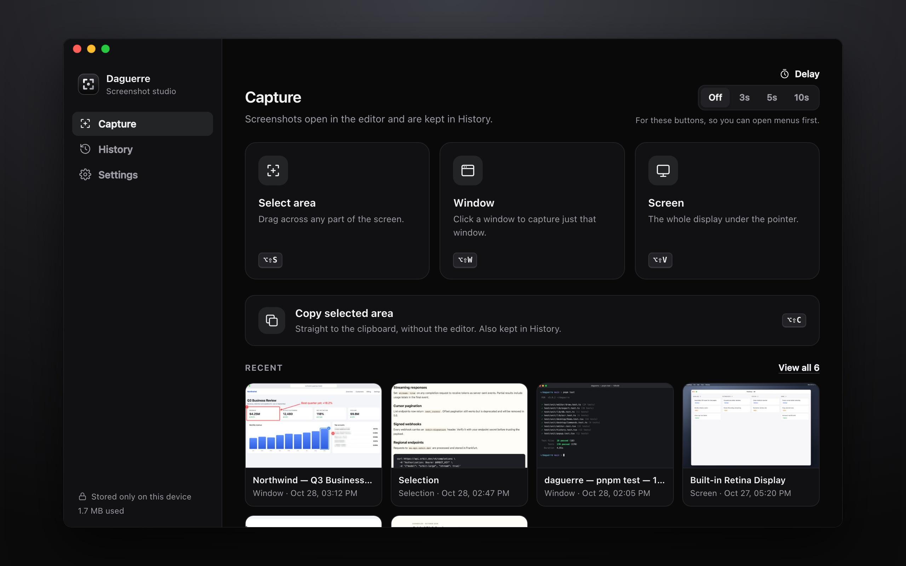
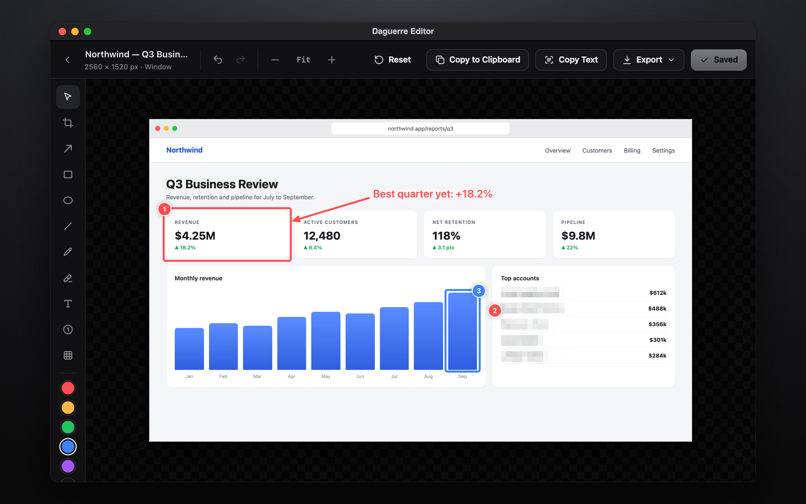
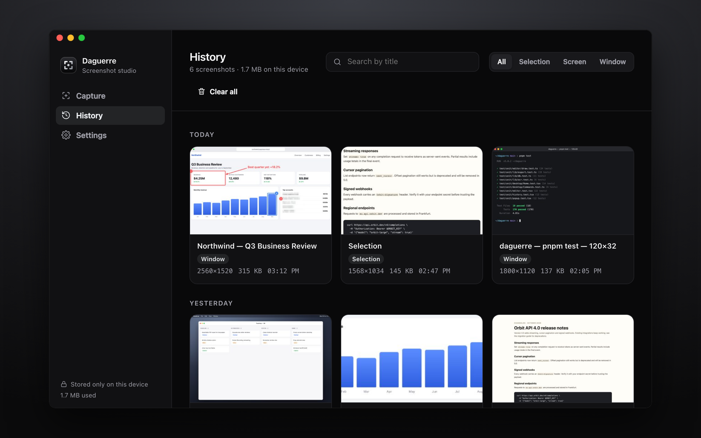
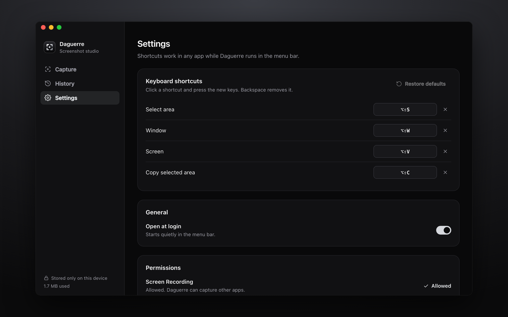

<div align="center">


# Daguerre

**Screenshots, plated in silver.** Capture, annotate and export screenshots in Chrome or with the desktop app for macOS, Windows and Linux, without anything leaving your device.

[](https://github.com/MohammadMahmoud/Daguerre/actions/workflows/ci.yml)
[](https://OWNER.github.io/REPO/coverage/)
[](https://github.com/MohammadMahmoud/Daguerre/releases/latest)


**[See the interactive showcase →](https://OWNER.github.io/REPO/)**

</div>

> Named after Louis Daguerre, whose 1839 daguerreotype fixed the first practical photographs on silver-plated copper.

## ✨ Features

|                            |                                                                                                                                                                              |
| -------------------------- | ---------------------------------------------------------------------------------------------------------------------------------------------------------------------------- |
| 📸 **Four capture modes**  | Visible area, entire page (scrolls and stitches, hiding repeated sticky headers), a selected area, or every tab in the window.                                               |
| ↕️ **Scrolling selection** | Drag to the top or bottom edge, or scroll, while selecting. Areas taller than the screen are stitched automatically.                                                         |
| ✏️ **Editor**              | Crop with drag handles, arrows, shapes, pen, highlighter, text, numbered steps, and pixelate for hiding sensitive details. Drag past the edge of the view to keep scrolling. |
| 🔁 **Re-editable**         | The original capture and your edits are stored separately. Undo, redo or reset at any time.                                                                                  |
| 📤 **Export**              | Lossless PNG; compressed JPEG or WebP with a quality slider and live size estimates; multi-page PDF; clipboard; print.                                                       |
| 🔤 **Text recognition**    | **Copy Text** from any screenshot and export **Searchable PDFs**, all offline (English).                                                                                     |
| 🗂️ **History**             | Grouped by day, with search, filters, bulk delete with undo, and a storage meter.                                                                                            |
| ⏱️ **Delay timer**         | 3, 5 or 10 seconds, to open menus or hover states before the capture.                                                                                                        |
| 🖥️ **Desktop app**         | Select an area, a window or a whole screen in any app, with global shortcuts and a menu bar or tray icon. See **Desktop app** below.                                         |
| 🔒 **Private by design**   | No servers, analytics or tracking. Screenshots stay on your device, in the browser's IndexedDB or the desktop app's local storage.                                           |

<table>
  <tr>
    <td></td>
    <td></td>
  </tr>
  <tr>
    <td></td>
    <td></td>
  </tr>
</table>

Choose **Copy selected area** in the popup, or press **Alt+Shift+C**, to select and copy an area without opening the editor. The capture stays in local History for editing later. Other capture actions open the editor as usual.

## ⌨️ Shortcuts

| Action                          | Shortcut                                                                                                                                                                                                                                       |
| ------------------------------- | ---------------------------------------------------------------------------------------------------------------------------------------------------------------------------------------------------------------------------------------------- |
| Copy selected area to clipboard | <kbd>Alt</kbd> + <kbd>Shift</kbd> + <kbd>C</kbd>                                                                                                                                                                                               |
| Capture visible area            | <kbd>Alt</kbd> + <kbd>Shift</kbd> + <kbd>V</kbd>                                                                                                                                                                                               |
| Capture entire page             | <kbd>Alt</kbd> + <kbd>Shift</kbd> + <kbd>F</kbd>                                                                                                                                                                                               |
| Capture selected area           | <kbd>Alt</kbd> + <kbd>Shift</kbd> + <kbd>S</kbd>                                                                                                                                                                                               |
| Editor tools                    | <kbd>V</kbd> select · <kbd>C</kbd> crop · <kbd>A</kbd> arrow · <kbd>R</kbd> rectangle · <kbd>O</kbd> ellipse · <kbd>L</kbd> line · <kbd>P</kbd> pen · <kbd>H</kbd> highlighter · <kbd>T</kbd> text · <kbd>N</kbd> step · <kbd>B</kbd> pixelate |
| Undo / redo                     | <kbd>⌘</kbd> <kbd>Z</kbd> / <kbd>⇧</kbd> <kbd>⌘</kbd> <kbd>Z</kbd>                                                                                                                                                                             |
| Copy image / copy text          | <kbd>⌘</kbd> <kbd>C</kbd> / <kbd>⇧</kbd> <kbd>⌘</kbd> <kbd>C</kbd>                                                                                                                                                                             |
| Save / print                    | <kbd>⌘</kbd> <kbd>S</kbd> / <kbd>⌘</kbd> <kbd>P</kbd>                                                                                                                                                                                          |
| Apply crop                      | <kbd>Enter</kbd>                                                                                                                                                                                                                               |

Capture shortcuts default to **Alt+Shift** on Windows and Linux, and **Option+Shift** on macOS, with the letters shown above. Existing custom assignments are preserved; browser, OS, or other extension shortcuts may prevent a default from registering.

Change the capture shortcuts at `chrome://extensions/shortcuts`.

## 🚀 Getting started

```sh
pnpm install
pnpm build        # typecheck + build into dist/
```

Open `chrome://extensions`, turn on **Developer mode**, click **Load unpacked** and pick `dist/`. After each rebuild, click the reload button on the extension card.

| Script                         | What it does                                                                                 |
| ------------------------------ | -------------------------------------------------------------------------------------------- |
| `pnpm dev`                     | Rebuild on change                                                                            |
| `pnpm test`                    | Unit and component tests (Vitest + jsdom)                                                    |
| `pnpm coverage`                | Tests with a coverage report; fails below 80% (report in `coverage/`)                        |
| `pnpm icons`                   | Regenerate `public/icons`                                                                    |
| `pnpm package`                 | Build, run tests with coverage, and zip `dist/` into `daguerre.zip` for the Web Store        |
| `pnpm release-notes extension` | Write `release-notes.md` from `CHANGELOG.md` (or `desktop`); fails if the section is missing |
| `pnpm lint`                    | ESLint (TypeScript and React Hooks rules); fails on any warning                              |
| `pnpm format`                  | Format everything with Prettier (`pnpm format:check` only checks)                            |

Git hooks ([husky](https://typicode.github.io/husky/)) are installed by `pnpm install`:

- **pre-commit:** ESLint (with `--fix`) and Prettier on the staged files ([lint-staged](https://github.com/lint-staged/lint-staged)), then the unit tests.
- **pre-push:** `pnpm lint`, `pnpm format:check`, `pnpm typecheck` and the unit tests.

CI runs the same checks, so skipping a hook with `--no-verify` only moves the failure to the pull request. The project builds with TypeScript 7, which has no JavaScript API; [.pnpmfile.cjs](.pnpmfile.cjs) gives typescript-eslint the TypeScript 6 API instead.

## 🖥️ Desktop app

The same editor, History, OCR and export, as a desktop app for macOS, Windows and Linux. It is built with [Tauri 2](https://v2.tauri.app/): Rust captures screens and windows ([xcap](https://github.com/nashaofu/xcap)), shows the selection overlay, registers global shortcuts and writes the clipboard, while the web UI from `src/` is reused. Screenshots stay in the app's local storage.

The main window has three sections: **Capture** (the three capture modes, copy to clipboard, a delay and your recent captures), **History** (search, filters, bulk delete) and **Settings** (shortcuts, open at login, permissions). Each screenshot opens in its own editor window, which asks before closing with unsaved changes. Closing the main window keeps Daguerre running in the menu bar or system tray, where it still answers shortcuts; the tray menu has every capture plus History and Settings. Window sizes and positions are remembered.

<table>
  <tr>
    <td></td>
    <td></td>
  </tr>
  <tr>
    <td></td>
    <td></td>
  </tr>
</table>

| Download from a release         | File                                                              |
| ------------------------------- | ----------------------------------------------------------------- |
| macOS (Apple silicon and Intel) | `Daguerre_<version>_universal.dmg`                                |
| Windows                         | `Daguerre_<version>_x64-setup.exe` or `.msi`                      |
| Linux                           | `.AppImage`, `.deb` (Debian, Ubuntu) or `.rpm` (Fedora, openSUSE) |

Each release also lists `SHA256SUMS.txt` to check your download (`shasum -a 256 -c SHA256SUMS.txt --ignore-missing`).

| Action             | Default shortcut                                                |
| ------------------ | --------------------------------------------------------------- |
| Select area        | <kbd>Alt</kbd> + <kbd>Shift</kbd> + <kbd>S</kbd> (⌥⇧S on macOS) |
| Window             | <kbd>Alt</kbd> + <kbd>Shift</kbd> + <kbd>W</kbd> (⌥⇧W)          |
| Screen             | <kbd>Alt</kbd> + <kbd>Shift</kbd> + <kbd>V</kbd> (⌥⇧V)          |
| Copy selected area | <kbd>Alt</kbd> + <kbd>Shift</kbd> + <kbd>C</kbd> (⌥⇧C)          |

Change them in **Settings** (shortcuts pause while you record a new one). Selections freeze the screen first, so menus and hover states stay in the shot; press <kbd>Esc</kbd> to cancel.

- **macOS:** allow **Screen Recording** for Daguerre (the app shows an **Allow** button), then quit and reopen it. Unless the release was signed (see below), builds are ad-hoc signed and not notarized: if macOS blocks the first launch, click **Open Anyway** in System Settings → Privacy & Security, or run `xattr -dr com.apple.quarantine /Applications/Daguerre.app`. The Dock icon shows only while a Daguerre window is open. The first time you print, macOS asks to let Daguerre find devices on your local network; that's the print panel looking for printers, and printing to PDF works either way.
- **Windows:** unsigned installers show a SmartScreen warning; choose **More info → Run anyway**.
- **Linux (Wayland):** apps can't register global shortcuts. Bind `daguerre --capture selection` (or `window`, `screen`, `copy-selection`) in your desktop's keyboard settings. Window picking needs X11.

Build from source with Rust 1.90 or newer ([rustup](https://rustup.rs); make sure `cargo` is on your `PATH`). On Linux, first install the [Tauri prerequisites](https://v2.tauri.app/start/prerequisites/#linux) plus `libxcb1-dev libxrandr-dev libdbus-1-dev libpipewire-0.3-dev libwayland-dev libegl-dev libgbm-dev libclang-dev`.

| Script               | What it does                                                          |
| -------------------- | --------------------------------------------------------------------- |
| `pnpm desktop:dev`   | Build the UI and run the app, rebuilding the UI on change             |
| `pnpm desktop:build` | Typecheck and build installers into `src-tauri/target/release/bundle` |

The Rust side lives in `src-tauri/` (`capture.rs`, `selection.rs`, `lib.rs`); each window only gets the commands listed in `src-tauri/capabilities/`. Run its checks with `cargo fmt --check`, `cargo clippy --all-targets -- -D warnings` and `cargo test` inside `src-tauri/`.

## 🧪 Tests

Unit and component tests live in `test/unit/`, mirroring `src/`. Shared setup is in `test/setup.ts`, and `test/chrome.ts` is an in-memory stand-in for the extension APIs. They run in Vitest with jsdom, fake IndexedDB and a canvas mock, and coverage must stay at or above 80% for statements, branches, functions and lines.

```
test/
├── chrome.ts        # chrome.* API mock
├── setup.ts         # jsdom polyfills (canvas, ImageBitmap, clipboard, layout)
└── unit/
    ├── background.test.ts
    ├── editor.test.tsx
    ├── history.test.tsx
    ├── popup.test.tsx
    ├── desktop/{Capture,Desktop,Shortcuts}.test.ts, {Editor,Home,Overlay}.test.tsx
    ├── editor/draw.test.ts
    ├── lib/{db,export,ocr}.test.ts
    └── ui.test.tsx
```

The Rust code in `src-tauri/` has its own unit tests (`cargo test`) for coordinate mapping, window picking, command-line arguments, shortcut filtering and editor window labels.

## ⚙️ CI and releases

[`.github/workflows/ci.yml`](.github/workflows/ci.yml) runs on every push and pull request. The extension and the desktop app share code but have their own versions, tags and releases, and CI only builds what a change touches ([`scripts/changed.mjs`](scripts/changed.mjs)): shared code (editor, history, `src/lib`, dependencies, build config) counts for both, and docs or the store site for neither.

1. **Changes:** decides which products to build. A tag builds only its product; manual runs (**Actions → CI → Run workflow**) build both.
2. **Test:** always runs typecheck, lint, format check and the unit tests with coverage. The job fails below 80% and posts a coverage summary on the run.
3. **Package (extension):** runs `pnpm package` and uploads `daguerre-extension-<version>.zip`.
4. **Desktop checks:** on macOS, Windows and Ubuntu, `cargo fmt --check`, `clippy` (warnings fail) and `cargo test`.
5. **Installers (desktop):** on `main`, `desktop-v*` tags and manual runs, it builds the universal `.dmg`, the Windows `.exe` and `.msi`, and the Linux `.AppImage`, `.deb` and `.rpm`, and uploads them as artifacts. Pull requests stop after the checks.
6. **Release:** an `ext-v*` tag creates a release with the extension zip; a `desktop-v*` tag, one with the installers. Both include `SHA256SUMS.txt` and that version's changelog as the notes.
7. **Pages:** on `main`, it publishes the [showcase](store/index.html), the [privacy policy](store/privacy.html), the coverage report and the coverage badge.

To ship a product, bump its version, add a matching section to [CHANGELOG.md](CHANGELOG.md), then tag and push. The workflow fails if the tag, the version and the changelog don't agree; `pnpm release-notes <extension|desktop>` checks the same locally.

| Product   | Version in                           | Changelog section      | Tag              |
| --------- | ------------------------------------ | ---------------------- | ---------------- |
| Extension | `public/manifest.json`               | `## [Extension x.y.z]` | `ext-vx.y.z`     |
| Desktop   | `src-tauri/Cargo.toml` (`[package]`) | `## [Desktop x.y.z]`   | `desktop-vx.y.z` |

```sh
git tag ext-v1.0.1 && git push origin ext-v1.0.1
```

One-time setup: in **Settings → Pages**, set **Source** to **GitHub Actions**. Then replace `MohammadMahmoud/Daguerre` in this README with your repository.

**Optional macOS signing and notarization:** add these repository secrets and the next build signs and notarizes the `.dmg` (without them it stays ad-hoc signed): `APPLE_CERTIFICATE` (base64 `.p12` Developer ID Application certificate), `APPLE_CERTIFICATE_PASSWORD`, `APPLE_SIGNING_IDENTITY`, `APPLE_ID`, `APPLE_PASSWORD` (an app-specific password) and `APPLE_TEAM_ID`. See [Tauri's macOS signing guide](https://v2.tauri.app/distribute/sign/macos/).

## 🛡️ Permissions

The extension asks for:

| Permission                    | Why                                                                           |
| ----------------------------- | ----------------------------------------------------------------------------- |
| `activeTab`                   | Capture the tab you chose from the toolbar, shortcut or right-click menu      |
| `scripting`                   | Scroll the page for full-page and tall selections; show the selection overlay |
| `storage`, `unlimitedStorage` | Settings and the local screenshot history                                     |
| `contextMenus`                | Right-click capture commands                                                  |
| `clipboardWrite`              | Copy images and recognized text                                               |
| `<all_urls>` _(optional)_     | Requested only the first time you choose **All tabs**                         |

There's no `tabs` permission and no remote code; the OCR engine ships inside the extension under `ocr/`.

On macOS, the desktop app needs **Screen Recording**, and printing may ask for local network access to find printers. Each of its windows can only call the commands listed in `src-tauri/capabilities/`.

## 📦 Publishing

- [store/listing.md](store/listing.md): listing copy, permission justifications and a submission checklist.
- [store/index.html](store/index.html): the interactive showcase site (served by GitHub Pages).
- [store/privacy.html](store/privacy.html): the privacy policy to link from the store.
- `store/`: 1280×800 screenshots and the 440×280 promo tile.
- `store/desktop/`: desktop app screenshots for this README (not part of the Web Store listing).

## ⚠️ Known limits

- Chrome blocks capturing `chrome://` pages and the Chrome Web Store.
- Full-page capture scrolls the main document. Pages that scroll an inner container (for example, some web apps) are captured as the visible area only.
- Very long pages are cut at Chrome's canvas limit (about 32,000 px tall).
- OCR reads English only, and the searchable PDF's text layer covers Latin characters only. Words that cross a 4,000 px band boundary may be split.
- Desktop: a selection stays within one display, and there's no scrolling capture of other apps.

## 🙏 Credits

Text recognition by [Tesseract.js](https://github.com/naptha/tesseract.js) (Apache-2.0).

Daguerre is licensed under the [MIT License](LICENSE).
